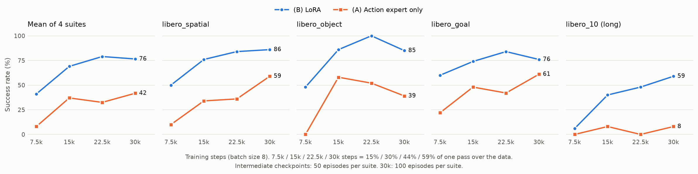

# 실험 결과: Action expert only (A) vs LoRA (B)

표준 LIBERO 4개 suite와 LIBERO-Plus 3개 변화 범주의 결과입니다. 평가 영상은 용량 때문에 저장소에 넣지 않았습니다.

요약: B(LoRA)가 표준 LIBERO의 4개 suite 모두에서 A보다 높았고(평균 76.5% 대 41.8%), 처음 보는 지시문·배경·조명 변화에서도 높았습니다(34.0% 대 5.5%). "단순한 태스크는 action expert만으로 충분하다"는 가설은 지지되지 않았습니다.

실험 설정과 코드 설명은 저장소 루트의 `README_LIBERO_AB.md`를 보세요.

## 표준 LIBERO 성공률

30,000 step 체크포인트, suite당 10태스크 × 10회 = 100 에피소드입니다. 괄호는 Wilson 95% 구간입니다.

| 그룹 | Suite | (A) Action expert only | (B) LoRA | B − A (%p) |
|---|---|---|---|---|
| 단순 | libero_spatial | 59 (49~68) | 86 (78~91) | +27 |
| 단순 | libero_object | 39 (30~49) | 85 (77~91) | +46 |
| 복잡 | libero_goal | 61 (51~70) | 76 (67~83) | +15 |
| 복잡 | libero_10 | 8 (4~15) | 59 (49~68) | +51 |
| 단순 평균 | 200 에피소드 | 49.0 | 85.5 | +36.5 |
| 복잡 평균 | 200 에피소드 | 34.5 | 67.5 | +33.0 |
| 전체 평균 | 400 에피소드 | 41.8 | 76.5 | +34.8 |

단순/복잡 그룹 분류는 평가 전에 정했습니다.

## 태스크 단위 비교

같은 태스크의 10회는 서로 독립이 아니므로, 차이의 확실성은 태스크 10개를 A와 B로 짝지은 비교로 판단합니다.

| Suite | B − A 평균 (%p) | 95% 구간 (태스크 10개, paired t) | B가 높은 / 같은 / 낮은 태스크 |
|---|---|---|---|
| libero_10 | +51 | +23 ~ +79 | 8 / 2 / 0 |
| libero_object | +46 | +27 ~ +65 | 10 / 0 / 0 |
| libero_spatial | +27 | +10 ~ +44 | 9 / 0 / 1 |
| libero_goal | +15 | −4 ~ +34 | 7 / 1 / 2 |

태스크별 성공률 (suite 안의 태스크 순서대로):

| Suite | 기법 | 태스크 1~10 |
|---|---|---|
| libero_spatial | A | 0.9 0.7 0.8 0.7 0.0 0.5 0.5 0.7 0.8 0.3 |
| libero_spatial | B | 1.0 0.9 1.0 1.0 0.4 0.3 1.0 1.0 1.0 1.0 |
| libero_object | A | 0.4 0.3 0.7 0.5 0.5 0.3 0.4 0.1 0.1 0.6 |
| libero_object | B | 0.8 1.0 0.8 0.7 0.8 0.6 1.0 1.0 0.9 0.9 |
| libero_goal | A | 0.7 0.9 0.7 0.3 0.7 0.4 0.6 0.9 0.8 0.1 |
| libero_goal | B | 0.3 1.0 0.9 0.8 0.9 0.8 0.9 0.9 0.7 0.4 |
| libero_10 | A | 0.0 0.0 0.1 0.1 0.0 0.4 0.1 0.1 0.0 0.0 |
| libero_10 | B | 0.9 1.0 0.9 0.7 0.7 0.4 0.2 0.9 0.0 0.2 |

## LIBERO-Plus 성공률

학습에 쓰지 않은 변화를 가한 환경에서 같은 두 체크포인트를 평가했습니다. 추가 학습은 없습니다. 범주별 태스크(1,537 / 1,076 / 1,138개)에서 일정 간격(10 / 7 / 7)으로 뽑아 A와 B에 같은 태스크를 썼고, 태스크당 1회입니다. 괄호는 Wilson 95% 구간입니다.

| 변화 종류 | 에피소드 | (A) Action expert only | (B) LoRA | B − A (%p) |
|---|---|---|---|---|
| Language Instructions | 154 | 8.4 (5~14) | 31.8 (25~40) | +23.4 (15~32) |
| Background Textures | 154 | 2.6 (1~6) | 39.0 (32~47) | +36.4 (28~44) |
| Light Conditions | 163 | 5.5 (3~10) | 31.3 (25~39) | +25.8 (18~34) |
| 합계 | 471 | 5.5 (4~8) | 34.0 (30~38) | +28.5 (24~33) |

같은 태스크끼리 짝지은 비교 (에피소드 수):

| 변화 종류 | 둘 다 성공 | A만 성공 | B만 성공 | 둘 다 실패 | McNemar p |
|---|---|---|---|---|---|
| Language Instructions | 4 | 9 | 45 | 96 | 7e-7 |
| Background Textures | 1 | 3 | 59 | 91 | 2e-14 |
| Light Conditions | 4 | 5 | 47 | 107 | 1e-9 |

원래 suite별로 나눈 성공률 (%, 괄호는 성공 수/에피소드 수). 칸마다 36~42 에피소드라 오차가 큽니다(대략 ±15%p).

| 변화 종류 | 기법 | spatial | object | goal | libero_10 |
|---|---|---|---|---|---|
| Language | A | 10 (4/39) | 11 (4/36) | 12 (5/41) | 0 (0/38) |
| Language | B | 41 (16/39) | 39 (14/36) | 29 (12/41) | 18 (7/38) |
| Background | A | 0 (0/37) | 6 (2/36) | 5 (2/40) | 0 (0/41) |
| Background | B | 78 (29/37) | 36 (13/36) | 30 (12/40) | 15 (6/41) |
| Light | A | 2 (1/42) | 7 (3/42) | 13 (5/40) | 0 (0/39) |
| Light | B | 19 (8/42) | 55 (23/42) | 43 (17/40) | 8 (3/39) |
| 세 범주 합계 | A | 4 (5/118) | 8 (9/114) | 10 (12/121) | 0 (0/118) |
| 세 범주 합계 | B | 45 (53/118) | 44 (50/114) | 34 (41/121) | 14 (16/118) |
| 표준 LIBERO (참고) | A / B | 59 / 86 | 39 / 85 | 61 / 76 | 8 / 59 |

- A는 변화를 가하면 모든 suite에서 10% 이하로 떨어졌고, libero_10에서는 118개 중 하나도 성공하지 못했습니다.
- B는 A보다 훨씬 많이 버텼지만 표준 평가보다 크게 낮습니다. 471개 중 294개(62%)는 두 기법 모두 실패했습니다.
- 장면은 그대로 두고 지시문 표현만 바꾼 경우에도 시각 변화와 비슷한 폭으로 떨어졌습니다. 두 기법 모두 학습 때 본 지시문 문구에 의존합니다.
- B의 버티는 정도는 변화와 suite의 조합에 따라 크게 달랐습니다. 배경 변화에서는 spatial이 78%로 높고, 조명 변화에서는 spatial이 19%로 낮습니다. 칸당 표본이 작아 이 양상은 추가 확인이 필요합니다.
- suite 구분은 LIBERO-Plus의 `task_classification.json`과 벤치마크의 태스크 선택 규칙을 다시 계산해 붙인 것입니다. 세 범주의 전체 태스크 수가 평가 때 출력된 값과 일치하는 것을 확인했습니다.

## 세부 분석

로그와 평가 영상에서 추가로 확인한 내용입니다. 5번은 seed 하나의 관찰이라 가설 수준입니다.

**1. open-loop 오차의 작은 차이가 closed-loop 성공률에서는 크게 벌어졌습니다.**

| | (A) | (B) | 차이 |
|---|---|---|---|
| 학습 action loss (마지막 7,500 step 평균) | 0.077 | 0.064 | B가 17% 낮음 |
| open-loop 예측 오차 (`mse_score`, 같은 구간) | 0.0096 | 0.0080 | B가 17% 낮음 |
| 표준 LIBERO 성공률 | 41.8% | 76.5% | B가 1.8배 |
| libero_10 성공률 | 8% | 59% | B가 7배 |

**2. 두 기법 모두 학습이 덜 된 상태입니다.** 30,000 step은 데이터를 0.59회 통과한 양이고(로그의 `epoch` 값), loss는 끝까지 내려가고 있었습니다. 이 실험은 적은 학습 예산에서의 비교입니다.

구간별 평균 (action loss / open-loop 오차):

| step 구간 | (A) | (B) |
|---|---|---|
| 0 ~ 500 | 0.216 / 0.0194 | 0.209 / 0.0211 |
| 500 ~ 2,000 | 0.149 / 0.0158 | 0.127 / 0.0142 |
| 2,000 ~ 7,500 | 0.111 / 0.0129 | 0.094 / 0.0107 |
| 7,500 ~ 15,000 | 0.095 / 0.0107 | 0.081 / 0.0093 |
| 15,000 ~ 22,500 | 0.084 / 0.0099 | 0.072 / 0.0085 |
| 22,500 ~ 30,000 | 0.077 / 0.0096 | 0.064 / 0.0080 |

**3. A의 실패는 물체를 잘못 고르는 것이 아니라 집기와 놓기의 정밀도 문제였습니다.** libero_object에서 A가 실패한 61개 영상을 분류했습니다(아래 "실패 영상 분류"). 목표 물체 위치로 갔지만 들어 올리지 못한 경우가 44개(72%), 집어서 옮겼지만 바구니에 넣지 못한 경우가 16개(26%), 다른 위치로 간 경우가 1개였습니다. "A는 물체 구분이 약하다"는 처음의 추측은 영상으로 확인한 결과 맞지 않았습니다. 장면이 같고 지시문만 다른 libero_goal에서 A가 61%로 가장 높았던 것과 합치면, 동결한 VLM은 무엇을 어디서 할지는 전달하지만 정밀한 조작에 필요한 수준에는 못 미치는 것으로 보입니다.

**4. 긴 태스크에서 A는 첫 단계부터 실패했습니다.** libero_10의 "두 물체를 바구니에 넣기" 세 태스크에서 A는 30회 중 1회, B는 28회 성공했습니다. 그중 한 태스크(alphabet soup + tomato sauce)의 A 실패 영상 10개를 보면, 10개 모두 첫 번째 물체를 집지 못했습니다. 두 단계가 누적되어 실패한 것이 아니라 첫 집기에서 막힌 것입니다. 이 태스크들은 libero_object와 동작은 같지만 장면(탁자, 배경, 물체 배치)이 다릅니다.

**5. VLM을 동결해도 지시문 표현 변화에 강해지지 않았습니다.** LIBERO-Plus의 Language Instructions에서 A는 8.4%, B는 31.8%였습니다(표준 평균 41.8%, 76.5%). 지시문 40개로만 학습한 action expert가 특정 문구에 맞춰진 것으로 보입니다.

**6. B는 변화가 심할수록 떨어졌고, A는 전 단계에서 바닥이었습니다.** LIBERO-Plus 난이도별 성공률(세 범주 합계)입니다.

| 난이도 | 에피소드 | (A) | (B) |
|---|---|---|---|
| 1 | 88 | 6.8% | 43.2% |
| 2 | 97 | 3.1% | 37.1% |
| 3 | 82 | 6.1% | 31.7% |
| 4 | 98 | 6.1% | 32.7% |
| 5 | 85 | 4.7% | 23.5% |
| 표시 없음 | 21 | 9.5% | 38.1% |

**7. B가 낮아진 태스크와 둘 다 풀지 못한 태스크가 있습니다.** 표준 LIBERO의 태스크별 성공 횟수(10회 중)입니다.

| Suite | 태스크 | A | B |
|---|---|---|---|
| spatial | bowl between the plate and the ramekin | 9 | 10 |
| spatial | bowl next to the ramekin | 7 | 9 |
| spatial | bowl from table center | 8 | 10 |
| spatial | bowl on the cookie box | 7 | 10 |
| spatial | bowl in the top drawer of the wooden cabinet | 0 | 4 |
| spatial | bowl on the ramekin | 5 | 3 |
| spatial | bowl next to the cookie box | 5 | 10 |
| spatial | bowl on the stove | 7 | 10 |
| spatial | bowl next to the plate | 8 | 10 |
| spatial | bowl on the wooden cabinet | 3 | 10 |
| object | alphabet soup | 4 | 8 |
| object | cream cheese | 3 | 10 |
| object | salad dressing | 7 | 8 |
| object | bbq sauce | 5 | 7 |
| object | ketchup | 5 | 8 |
| object | tomato sauce | 3 | 6 |
| object | butter | 4 | 10 |
| object | milk | 1 | 10 |
| object | chocolate pudding | 1 | 9 |
| object | orange juice | 6 | 9 |
| goal | open the middle drawer of the cabinet | 7 | 3 |
| goal | put the bowl on the stove | 9 | 10 |
| goal | put the wine bottle on top of the cabinet | 7 | 9 |
| goal | open the top drawer and put the bowl inside | 3 | 8 |
| goal | put the bowl on top of the cabinet | 7 | 9 |
| goal | push the plate to the front of the stove | 4 | 8 |
| goal | put the cream cheese in the bowl | 6 | 9 |
| goal | turn on the stove | 9 | 9 |
| goal | put the bowl on the plate | 8 | 7 |
| goal | put the wine bottle on the rack | 1 | 4 |
| libero_10 | put both the alphabet soup and the tomato sauce in the basket | 0 | 9 |
| libero_10 | put both the cream cheese box and the butter in the basket | 0 | 10 |
| libero_10 | turn on the stove and put the moka pot on it | 1 | 9 |
| libero_10 | put the black bowl in the bottom drawer of the cabinet and close it | 1 | 7 |
| libero_10 | white mug on the left plate, yellow and white mug on the right plate | 0 | 7 |
| libero_10 | pick up the book and place it in the back compartment of the caddy | 4 | 4 |
| libero_10 | white mug on the plate, chocolate pudding to the right of the plate | 1 | 2 |
| libero_10 | put both the alphabet soup and the cream cheese box in the basket | 1 | 9 |
| libero_10 | put both moka pots on the stove | 0 | 0 |
| libero_10 | put the yellow and white mug in the microwave and close it | 0 | 2 |

**8. 성공할 때의 속도는 같았습니다.** 성공한 에피소드의 평균 소요 시간(초, 로그 시각 기준)은 spatial 5.8 / 5.7, object 6.0 / 6.3, goal 5.3 / 5.4, libero_10 10.1 / 12.1입니다(A / B).

## 실패 영상 분류

libero_object에서 A(30,000 step)가 실패한 영상 61개 전부를 분류했습니다. 영상마다 균등 간격으로 5~6장면을 뽑아, 같은 태스크의 성공 영상과 팔이 접근한 위치를 비교했습니다.

| 태스크 | 실패 수 | 집기 실패 | 놓기 실패 | 다른 위치 |
|---|---|---|---|---|
| milk | 9 | 9 | 0 | 0 |
| chocolate pudding | 9 | 0 | 8 | 1 |
| cream cheese | 7 | 7 | 0 | 0 |
| tomato sauce | 7 | 6 | 1 | 0 |
| alphabet soup | 6 | 4 | 2 | 0 |
| butter | 6 | 3 | 3 | 0 |
| bbq sauce | 5 | 5 | 0 | 0 |
| ketchup | 5 | 5 | 0 | 0 |
| orange juice | 4 | 3 | 1 | 0 |
| salad dressing | 3 | 2 | 1 | 0 |
| 합계 | 61 | 44 (72%) | 16 (26%) | 1 (2%) |

- 집기 실패: 목표 물체 위치로 갔지만 들어 올리지 못함. 물체 옆에서 멈춰 있거나, 밀거나, 넘어뜨림. milk는 9개 모두 우유팩을 옆으로 밀거나 넘어뜨렸습니다.
- 놓기 실패: 물체를 집어 바구니 쪽으로 옮겼지만 바구니 안에 넣지 못함(바구니 밖에 떨어뜨리거나 제한 시간 초과). chocolate pudding에 몰려 있습니다.
- 다른 위치: 목표와 다른 물체 쪽으로 감.

libero_10의 "put both the alphabet soup and the tomato sauce in the basket"에서 A가 실패한 10개는 모두 첫 번째 물체를 집지 못했습니다.

이 분류의 한계: 영상 전체가 아니라 뽑은 장면(256×256 해상도)을 보고 한 사람이 한 번 판정한 것입니다. "목표 물체로 갔다"는 판단은 성공 영상과 접근 위치가 같은지로 했으므로, 바로 옆 물체로 간 경우를 구분하지 못했을 수 있습니다. 논문에 쓰기 전에 영상 몇 개를 직접 확인하는 것을 권합니다.

## 학습 진행에 따른 성공률

중간 체크포인트(7,500 / 15,000 / 22,500 step)를 두 기법 모두 표준 LIBERO 4개 suite에서 평가했습니다. 중간 체크포인트는 suite당 10태스크 × 5회 = 50 에피소드, 30,000 step은 위의 100 에피소드 결과입니다. 30,000 step이 데이터 0.59회 통과이므로 각 시점은 데이터의 약 15% / 30% / 44% / 59%를 본 때입니다.



4개 suite 평균 (%):

| | 7,500 step | 15,000 | 22,500 | 30,000 |
|---|---|---|---|---|
| (A) Action expert only | 8.0 | 37.0 | 32.5 | 41.8 |
| (B) LoRA | 41.0 | 69.0 | 79.0 | 76.5 |
| B − A (%p) | +33.0 | +32.0 | +46.5 | +34.8 |

Suite별 (%):

| Suite | 기법 | 7,500 | 15,000 | 22,500 | 30,000 |
|---|---|---|---|---|---|
| libero_spatial | A | 10 | 34 | 36 | 59 |
| libero_spatial | B | 50 | 76 | 84 | 86 |
| libero_object | A | 0 | 58 | 52 | 39 |
| libero_object | B | 48 | 86 | 100 | 85 |
| libero_goal | A | 22 | 48 | 42 | 61 |
| libero_goal | B | 60 | 74 | 84 | 76 |
| libero_10 | A | 0 | 8 | 0 | 8 |
| libero_10 | B | 6 | 40 | 48 | 59 |

- B는 4분의 1의 학습으로 A의 최종 수준에 도달했습니다. B의 7,500 step 평균(41.0%)이 A의 30,000 step 평균(41.8%)과 같습니다.
- A는 15,000 step 이후 평균이 37 → 33 → 42로 오차 범위 안에서 머물렀습니다. 같은 구간에서 학습 loss는 0.095에서 0.077로 계속 내려갔습니다.
- 격차는 7,500 step에서 이미 +33%p였고 끝까지 +32~47%p로 유지됐습니다. A가 따라잡는 중이라는 근거는 없습니다.
- libero_10에서 A는 네 시점 모두 8% 이하였습니다. B는 7,500과 15,000 step 사이에 풀리기 시작했습니다(6% → 40%).
- B의 평균은 22,500 step(79.0%)과 30,000 step(76.5%)이 비슷해, 이 예산 안에서 포화한 것으로 보입니다.

읽을 때 주의:

- 중간 체크포인트는 칸당 50 에피소드라 오차가 약 ±14%p이고, 평균(200 에피소드)은 약 ±7%p입니다. libero_object에서 A가 58 → 52 → 39, B가 100 → 85로 내려간 것은 이 범위 안입니다.
- 시연 개수를 줄인 데이터 ablation이 아닙니다. 모든 시연에서 골고루 뽑아 본 양이 달라진 것입니다.
- 학습률이 뒤로 갈수록 줄어드는 일정(cosine)이라, 중간 체크포인트는 "그 step 수로 학습을 끝내도록 설정했을 때"의 결과와 다를 수 있습니다.

## LoRA rank를 줄인 실험

"B가 높은 것은 학습 파라미터가 많아서인가"를 확인하려고, B에서 LoRA rank만 16에서 2로 줄여(alpha 32 → 4) 한 번 더 학습했습니다. 나머지 조건은 B와 같습니다(실제 적용된 설정 파일을 대조해 rank 외에 차이가 없음을 확인). LoRA 파라미터는 6.4M에서 0.8M이 되어, 학습 파라미터 전체가 A보다 0.5% 많습니다.

30,000 step, suite당 100 에피소드 (%):

| Suite | (A) LoRA 없음 | rank 2 | (B) rank 16 |
|---|---|---|---|
| libero_spatial | 59 | 72 | 86 |
| libero_object | 39 | 78 | 85 |
| libero_goal | 61 | 77 | 76 |
| libero_10 | 8 | 22 | 59 |
| 4개 suite 평균 | 41.8 | 62.3 | 76.5 |
| 한 단계 suite 3개 평균 | 53.0 | 75.7 | 82.3 |

| 항목 | (A) | rank 2 | (B) rank 16 |
|---|---|---|---|
| LoRA 파라미터 | 0 | 0.8M | 6.4M |
| 학습 파라미터 전체 | 155.2M | 156.0M | 161.6M |
| 학습 시간 | 8시간 10분 | 8시간 10분 | 8시간 18분 |
| 최대 VRAM | 12.7GB | 18.0GB | 18.1GB |
| 학습 action loss (마지막 7,500 step 평균) | 0.077 | 0.067 | 0.064 |
| 7,500 step 평균 성공률 (suite당 50 에피소드) | 8.0% | 32.0% | 41.0% |

- 한 단계짜리 태스크(spatial, object, goal)는 0.8M 파라미터의 LoRA로 대부분 회복됐습니다. A와 B 사이 격차의 약 77%가 메워졌고, object와 goal은 rank 16과 오차 범위 안에서 같습니다. 이 세 suite에서 B의 우위는 파라미터 수로 설명되지 않습니다.
- 긴 태스크(libero_10)는 22%로, 격차의 약 27%만 메워졌습니다. 여러 단계로 이어지는 태스크에는 더 큰 rank가 필요했습니다.
- VLM 적응은 모든 suite에서 필요했지만, 필요한 적응의 크기는 태스크 길이에 따라 달랐습니다. 처음 가설("태스크 유형에 따라 필요한 기법이 다르다")이 기각된 뒤, 다른 형태로 남은 부분입니다.
- rank를 줄여도 VRAM은 줄지 않았습니다(18.0GB 대 18.1GB). 메모리 비용은 LoRA 파라미터 수가 아니라 VLM을 거쳐 역전파하는 데서 나옵니다.
- seed 하나이고 rank가 0, 2, 16 세 점뿐입니다. 중간 rank(4, 8)는 확인하지 않았습니다.

## 학습 비용

RTX 4090 1장, 30,000 step, batch size 8입니다.

| 항목 | (A) | (B) |
|---|---|---|
| 학습 파라미터 (전체 약 2,770M) | 155.2M | 161.6M (LoRA 6.4M 추가) |
| 학습 시간 | 8시간 10분 | 8시간 18분 |
| 최대 VRAM | 12.7GB | 18.1GB |

두 학습 모두 데이터 읽기가 병목이라 전체 시간 차이가 작습니다. 모델 계산만 보면 step당 A 약 0.44초, B 약 0.60초입니다(로그 마지막 step 기준).

## 읽을 때 주의

- 모델 하나, seed 하나의 결과입니다.
- LIBERO-Plus에서 A가 바닥(0%)에 가까워, 변화에 따른 A와 B의 격차 변화는 제한적으로만 해석할 수 있습니다.
- libero_goal은 태스크 단위 구간이 0을 포함하므로 유의한 차이를 확인하지 못한 것으로 봅니다.
- 저자의 LIBERO 체크포인트는 VLM 전체를 더 큰 batch로 학습한 것입니다. 이 실험의 절대 성공률을 논문 수치와 직접 비교하지 않습니다.
- LoRA는 언어 모델에만 붙고 vision tower는 두 조건 모두 동결입니다.

## 폴더 구성

| 경로 | 내용 |
|---|---|
| `training/libero_A/`, `training/libero_B/` | 본 학습의 로그(`train.log`), 실제 적용된 설정(`config.yaml`), 정규화 통계, 1분 간격 VRAM 기록(`vram.csv`), 시작·종료 시각 |
| `training/smoke_tests/` | 본 학습 전 200 step 시험 로그. `test_B.log`에 LoRA 주입과 가중치 로딩 확인 줄이 있음. `test_B`는 데이터 로더 일꾼 4, `test_A`는 8로 돌아 속도를 서로 비교할 수 없음 |
| `eval_libero/<suite>/<체크포인트>/` | 위 표의 근거가 되는 평가 로그(`eval.log`)와 모델 서버 로그 |
| `eval_libero_plus/<범주>/<체크포인트>/` | LIBERO-Plus 평가 로그 |
| `environment/` | 세 conda 환경(학습, LIBERO, LIBERO-Plus)의 `pip freeze` |
| `eval_curve/<suite>/<체크포인트>/` | 중간 체크포인트 평가 로그 (24개) |
| `figures/success_curve.png` | 학습 진행에 따른 성공률 그림 |
| `training/libero_B_r2/`, `eval_rank/` | rank 2 실험의 학습 기록과 평가 로그 (30,000 step 4개, 7,500 step 4개) |
| `eval_quick/` | 예비 평가. A의 50 에피소드 평가 2개, 저자의 LIBERO 체크포인트로 평가 환경을 확인한 20 에피소드, 200 step 시험 체크포인트 10 에피소드 |

성공률을 로그에서 다시 뽑으려면 저장소 루트에서 실행합니다.

```bash
for f in experiment_results/eval_libero/*/*/eval.log; do
  echo "$f: $(grep -A1 'Total success rate' "$f" | grep -oE '[0-9]\.[0-9]+' | tail -n 1)"
done
```
